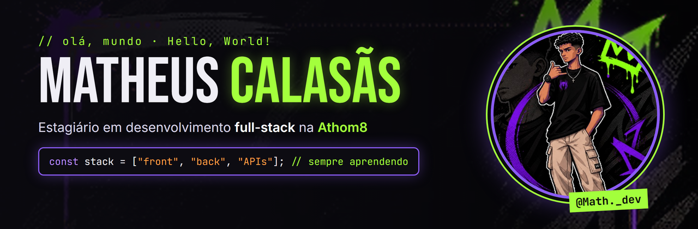

<div align="center">



<a href="https://git.io/typing-svg"></a>

<br><br>


</div>

```js
const matheus = {
  papel:    "Estagiário em desenvolvimento full-stack",
  curso:    "Análise e Desenvolvimento de Sistemas",
  foco:     ["Java", "Spring Boot", "Front-end", "APIs REST", "Banco de dados"],
  agora:    "Construindo projetos práticos com o que aprendo na faculdade",
  conteudo: "Criei o perfil no Instagram @Math._dev para ensinar o que sei.",
};
```

<div align="center">


<a href="mailto:matheuscalasas2004@hotmail.com"></a>
<a href="https://www.linkedin.com/in/matheuscalasas1"></a>
<a href="https://www.instagram.com/mthx.calasas/"></a>
<a href="https://www.instagram.com/math._dev/"></a>

<br><br>


<br><br>


<a href="https://github.com/Matheuscalasas1/BarberGo"></a>
<a href="https://github.com/Matheuscalasas1/AcadSystem"></a>
<a href="https://github.com/Matheuscalasas1/Projeto-Carfix"></a>
<a href="https://github.com/Matheuscalasas1/SoftScanner-leitor"></a>

<br><br>


<br><br>

<picture>
  <source media="(prefers-color-scheme: dark)" srcset="https://raw.githubusercontent.com/Matheuscalasas1/Matheuscalasas1/output/snake-roxo-dark.svg">
  <source media="(prefers-color-scheme: light)" srcset="https://raw.githubusercontent.com/Matheuscalasas1/Matheuscalasas1/output/snake-roxo.svg">
  
</picture>

<br><br>

<code>if (gostouDoPerfil) { seguir("@Matheuscalasas1"); deixarUmaEstrela(); } // ⭐</code>

</div>
