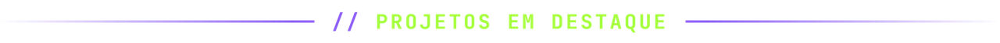
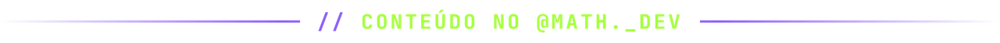
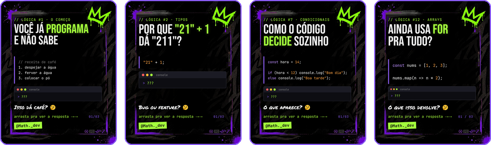
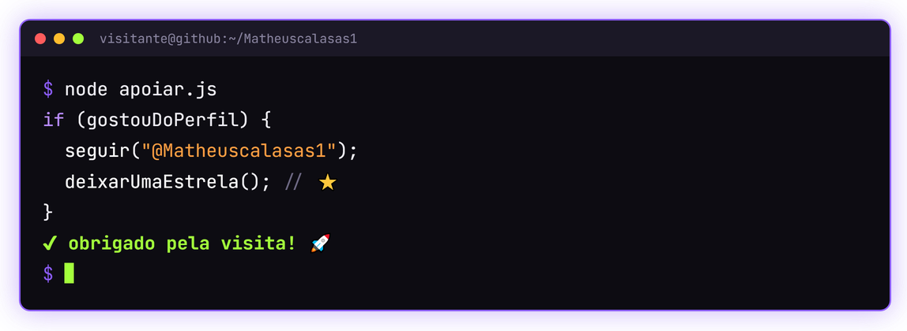

<div align="center">


<a href="https://git.io/typing-svg"></a>


<br><br>


</div>

```js
const matheus = {
  papel:    "Estagiário em desenvolvimento full-stack",
  curso:    "Análise e Desenvolvimento de Sistemas",
  stack:     ["Java", "Spring boot", "Python", "Django", "Typescript", "React Native", "APIs REST", "PostgreSQL", "MySQL", "SQL", "Docker"],
  agora:    "Construindo projetos práticos com o que aprendo na faculdade",
  conteudo: "Criei o perfil no Instagram @Math._dev para ensinar o que sei.",
};
```

<div align="center">


<a href="mailto:matheuscalasas2004@hotmail.com"></a>
<a href="https://www.linkedin.com/in/matheuscalasas/"></a>
<a href="https://www.instagram.com/mthx.calasas/"></a>
<a href="https://www.instagram.com/math._dev/"></a>

<br><br>


<sub><b>FOCO · JAVA</b></sub><br>


<sub><b>NO TRABALHO · PYTHON</b></sub><br>


<sub><b>FRONT-END</b></sub><br>


<sub><b>DADOS &amp; FERRAMENTAS</b></sub><br>


<br><br>


<table>
<tr><th>Projeto</th><th>Descrição</th><th>Tecnologias</th></tr>
<tr>
<td><a href="https://github.com/Matheuscalasas1/AcadSystem"><b>AcadSystem</b></a></td>
<td>Sistema de gestão acadêmica: alunos, coordenadores e relatórios</td>
<td>Java · Spring Boot · Spring Security · MySQL</td>
</tr>
<tr>
<td><a href="https://github.com/Matheuscalasas1/SoftScanner-leitor"><b>SoftScanner-leitor</b></a></td>
<td>Leitura de serial de rádios por código de barras, com histórico e exportação para Excel</td>
<td>Java · HTML · CSS</td>
</tr>
<tr>
<td><a href="https://github.com/Matheuscalasas1/BarberGo"><b>BarberGo</b></a></td>
<td>App mobile de barbearia</td>
<td>React Native · Expo · TypeScript · Supabase</td>
</tr>
<tr>
<td><a href="https://github.com/Matheuscalasas1/Projeto-Carfix"><b>Projeto-Carfix</b></a></td>
<td>Site que aproxima mecânicos e clientes</td>
<td>Python · Flask · JavaScript</td>
</tr>
</table>

<br><br>


<sub>Conteúdo sobre programação e o que aprendo no dia a dia, toda semana.</sub><br><br>
<a href="https://www.instagram.com/math._dev/"></a>

<br><br>


<br><br>

<picture>
  <source media="(prefers-color-scheme: dark)" srcset="https://raw.githubusercontent.com/Matheuscalasas1/Matheuscalasas1/output/snake-roxo-dark.svg">
  <source media="(prefers-color-scheme: light)" srcset="https://raw.githubusercontent.com/Matheuscalasas1/Matheuscalasas1/output/snake-roxo.svg">
  
</picture>

<br><br>



</div>
